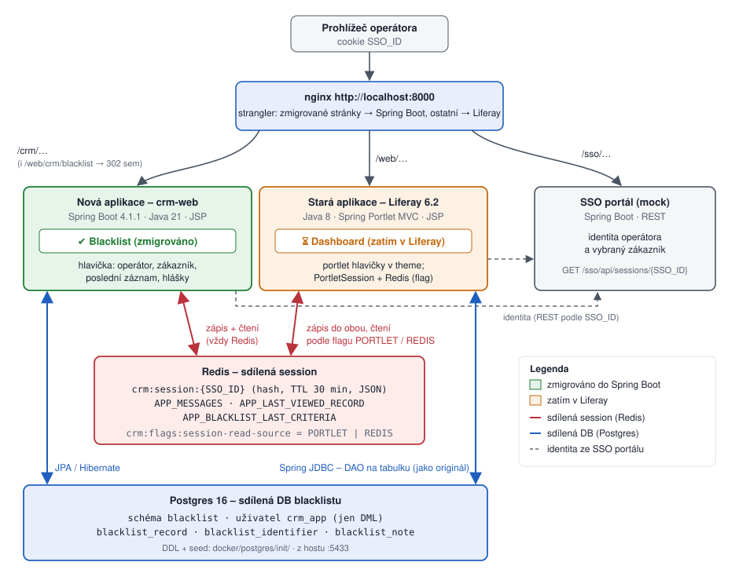

# Liferay → Spring Boot: výukové demo migrace



Ukázka toho, o co jde při migraci legacy CRM pro zákaznickou podporu z **Liferay 6.2** (Spring Portlet MVC + JSP)
na **Spring Boot**. Podle podkladů k migraci se Liferay odstraňuje, ale JSP, tagy a stavová session zůstávají.
Srozumitelnost a komentovaná rozhodnutí mají přednost před úplností.

## Architektura během migrace

- **nginx** je jediný vstup (`http://localhost:8000`). Zmigrované stránky směruje do Spring Boot, ostatní do Liferay
  (strangler): blacklist je už v nové aplikaci, dashboard zatím v Liferay.
- Identitu (operátor, zákazník) vlastní **SSO portál** – obě aplikace ji čtou podle cookie `SSO_ID`.
- **Redis** drží sdílenou session `crm:session:{SSO_ID}`. Nová aplikace do ní vždy zapisuje i z ní čte, stará zapisuje
  do PortletSession i do Redisu a čte podle flagu – aby viděla, co zapsala nová aplikace, musí být flag `REDIS`.
- Proklikání souběhu: [`crm-web/README.md`](crm-web/README.md); obsah session živě: `bash docker/show-session.sh`.
- **Blacklist standardně obsluhuje Java aplikace `crm-web`** (`/crm/…`) – sem vede odkaz „Blacklist“ v Liferay i `http://localhost:8000/`.
- **Bonus – Rust kopie** [`crm-web-rs/`](crm-web-rs/README.md): tentýž blacklist v Rustu (axum + askama) na vlastní cestě
  `http://localhost:8000/crm-rs/blacklist/search`. Pro migraci není potřeba; ukazuje, že identita a sdílená session
  fungují i s aplikací v jiném jazyce ([`docs/RUST.md`](docs/RUST.md)).
  - ⚡ **Výkon Java vs. Rust:** při stejné logice Rust zpracuje 2,6–4,8× více requestů s ~40× menší pamětí
    a zátěžový test odhalil dvě chyby, které funkční testy nezachytily – **[`docs/BENCHMARK.md`](docs/BENCHMARK.md)**
    (spuštění: `bash docker/bench.sh`).
  - 🎯 **Prezentace pro zákazníka** (Java → Rust, slajdy Marp): [`docs/PREZENTACIA-RUST.md`](docs/PREZENTACIA-RUST.md).

## Stav

| Fáze | Výstup | Stav |
|---|---|---|
| 1. Analýza legacy projektu | [`docs/ANALYZA.md`](docs/ANALYZA.md) | hotovo |
| Znalostní báze pro reálný projekt | [`poznamky/`](poznamky/README.md) | hotovo, průběžně se doplňuje |
| 2a. Stará aplikace „před“ (Liferay 6.2) | [`legacy/`](legacy/README.md), [`sso-mock/`](sso-mock), [`docker/`](docker) – [spec](docs/superpowers/specs/2026-10-12-legacy-liferay-app-design.md), [plán](docs/superpowers/plans/2026-10-12-legacy-liferay-app.md) | hotovo |
| 2b. Zmigrovaná aplikace „po“ (Spring Boot) | [`crm-web/`](crm-web/README.md), [`docs/MIGRACIA.md`](docs/MIGRACIA.md) – [spec](docs/superpowers/specs/2026-10-12-crm-web-migration-design.md), [plán](docs/superpowers/plans/2026-10-12-crm-web-migration.md) | hotovo – blacklist běží ve Spring Boot vedle Liferay |
| Bonus: Rust kopie `crm-web` | [`crm-web-rs/`](crm-web-rs/README.md), [`docs/RUST.md`](docs/RUST.md), [výkon](docs/BENCHMARK.md) – [spec](docs/superpowers/specs/2026-10-14-crm-web-rs-design.md), [plán](docs/superpowers/plans/2026-10-14-crm-web-rs.md) | hotovo – volitelná ukázka pod `/crm-rs`, Java aplikace zůstává výchozí |

## Co demo ukáže

Dva zmigrované portlety:
- **Blacklist ne-zákazníků**: render/action/resource fáze → GET / POST + redirect / AJAX, validace, ACL.
- **Zrušení služby**: dashboard dispatch podle parametru → běžné URL, kontext zákazníka, JSON endpoint.

U obou: ukázky „před → po“ a mapovací tabulka koncept Liferay → náhrada ve Spring Boot.

Stack: Java 21, Spring Boot 4.1.1, Maven, WAR + JSP, in-memory služby místo backendu.
Bonus `crm-web-rs`: Rust 1.98, axum + askama; build i testy v Dockeru (`bash crm-web-rs/test.sh`), lokální Rust není potřeba.

## Struktura

```
legacy/      stará aplikace na Liferay 6.2 (Java 8, Spring Portlet MVC) – 4 moduly jako legacy
crm-web/     nová aplikace (Spring Boot 4.1.1) se zmigrovaným blacklistem – běží souběžně se starou
crm-web-rs/  bonus: Rust kopie crm-web pod /crm-rs (volitelná, není součástí migrace)
sso-mock/    mock SSO portálu (Spring Boot 4.1.1)
docker/      Liferay 6.2 + Redis + RedisInsight + SSO mock + nginx, skripty (build, smoke, sdílená session)
docs/        analýza, (později) MIGRACIA.md, superpowers spec + plány
poznamky/    přenositelná znalostní báze: kde co hledat, mapa konceptů, playbook, pasti
input/       klientské podklady – git-ignorované, read-only, nejsou součástí repa
```

## Anonymizace

Repo neobsahuje klientský kód, názvy klienta, interní URL, hesla ani data z logů. Ukázky „před“ jsou napsané znovu.
Mapování aliasů na skutečné názvy je v lokálních souborech `poznamky/LOCAL-*`; ty jsou git-ignorované a přenášejí se ručně.
